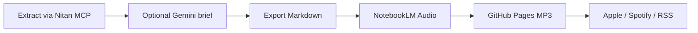

# Nitan Podcast

Weekly Chinese podcast generated from hot discussions on USCardForum.


`Nitan Podcast` is the public show repository: it owns the podcast identity, feed, episode assets, forum post templates, and the Nitan/USCardForum-specific logic behind each episode. Reusable pipeline stages are provided by the pinned `CastForge` dependency; this repo remains the canonical home of the show.

**Forum thread:** [【Nitan Podcast】你的每周美卡论坛精华播客](https://www.uscardforum.com/t/topic/494521)



## Subscribe

| Platform | Link |
| -------- | ---- |
| **Apple Podcasts** | [Nitan Podcast](https://podcasts.apple.com/us/podcast/nitan-podcast/id1888784962) |
| **Spotify** | [Nitan Podcast](https://open.spotify.com/show/3jjd0ozToYgW7yje7mfYCg) |
| **RSS** | `https://lifan-builds.github.io/nitan-podcast/feed.xml` |
| **美卡论坛** | [announcement thread](https://www.uscardforum.com/t/topic/494521) |

The [public episode archive](https://lifan-builds.github.io/nitan-podcast/) includes an in-browser player and source notes. See [the 18-episode retrospective](RETROSPECTIVE.md) and [August 2026 baseline](METRICS.md) for what the project learned before the CastForge growth launch.

## Public Compatibility Contract

The automation runs through `CastForge`, but the subscriber-facing surface of this show must stay stable.

- Feed URL stays `https://lifan-builds.github.io/nitan-podcast/feed.xml`
- Site URL stays `https://lifan-builds.github.io/nitan-podcast/`
- Episode URLs stay `https://lifan-builds.github.io/nitan-podcast/episodes/weekly_meika_YYYY-Www.mp3`
- Episode GUIDs keep the `nitan-podcast-YYYY-Www` format
- `docs/feed.xml` and `docs/episodes/` remain the publication targets

That is what keeps Spotify and Apple Podcasts from seeing the migration as a broken or new feed.

## What This Repo Owns

- Nitan MCP extraction and thread-selection logic
- Category voice and Story Brief editorial rules
- Chinese editorial prompts and podcast/forum copy
- Podcast metadata and RSS identity
- `docs/feed.xml` and `docs/episodes/*.mp3`
- Show assets such as cover art
- Validation and tests for this show's public contract

## What `CastForge` Owns

- reusable pipeline stages
- shared integrations for LLM and audio tooling
- framework-level orchestration and contracts

This repository owns the weekly schedule, runner setup, workflow gates, publication, and idempotency policy.

See `podcast.yaml` for the instance contract exposed to `CastForge`, and `docs/castforge-migration.md` for the current integration boundary.

## Quick Start

```bash
git clone https://github.com/lifan-builds/nitan-podcast.git
cd nitan-podcast
python3 -m venv .venv && source .venv/bin/activate
pip install -r requirements.txt
cp .env.example .env
```

`requirements.txt` installs the pinned CastForge release and show-specific dependencies. Configure `MCP_*`, optional `GEMINI_API_KEY`, and `NOTEBOOKLM_*` in `.env`.

## Run The Podcast Pipeline

```bash
python run_pipeline.py --dated
python run_pipeline.py --dated --skip-briefing
python run_pipeline.py --dated --publish-notebooklm
python run_pipeline.py --dated --generate-post --generate-rss --audio-url "https://..."

# Dry run without MCP
EXTRACTION_FIXTURE_PATH=fixtures/sample_extraction.json python run_pipeline.py --skip-briefing --dated
```

Stdout prints the primary output path. See `python run_pipeline.py --help` for the full CLI.

## NotebookLM Setup

For `--publish-notebooklm` using [notebooklm-py](https://github.com/teng-lin/notebooklm-py):

1. `pip install -r requirements-integrations.txt && playwright install chromium`
2. Run `notebooklm login`
3. Set `NOTEBOOKLM_NOTEBOOK_ID` in `.env`

The SDK saves a separate login from your normal Chrome Google sign-in. Current
versions use `~/.notebooklm/profiles/default/storage_state.json`, with a fallback
for older installations. Set `NOTEBOOKLM_STORAGE_PATH` to select an explicit file.

If a scheduled run reports expired authentication, run
`.venv/bin/python scripts/check_notebooklm_auth.py --env-file "$HOME/.nitan-podcast/.env"`
from the runner checkout. Follow its login command on the runner Mac, complete
Google sign-in locally, and run the check again before retrying the workflow.
The recovery command uses system Chrome and `--fresh` to discard the SDK's stale
browser session; it does not reset your ordinary Chrome profile. A login command
reporting that it saved authentication is not enough: the preflight must pass.
Do not put session files, passwords, or login codes in GitHub secrets or logs.
The preflight checks both the saved login and access to the configured notebook
before collecting forum content. Export-only and supplied-audio runs skip it.

## Automation

This repo owns its own weekly schedule and GitHub Actions workflow. Pipeline execution is powered by `CastForge`, installed from the `v0.1.3` tag through `requirements.txt`. The workflow does not install a second CastForge copy.

The workflow runs on a **self-hosted macOS runner** with three Sunday retry windows (6 AM / 12 PM / 6 PM PST; 7 AM / 1 PM / 7 PM PDT). First success publishes the episode; subsequent triggers skip. Episode weeks use `America/Los_Angeles`, including the evening retry that falls on Monday in UTC.

Pipeline phases:

0. Verify NotebookLM login and notebook access when generating audio
1. MCP extract + optional Gemini briefing + export Markdown
2. NotebookLM Audio Overview + download, normalize to real MP3, measure duration
3. GitHub Release (backup) + copy MP3 to `docs/episodes/`
4. Generate RSS feed + forum post draft
5. Commit + push (GitHub Pages auto-deploys)
6. Validate live feed

**Manual trigger:** Actions tab, `weekly-podcast`, Run workflow.

Install FFmpeg on the runner (`brew install ffmpeg`). NotebookLM may return AAC
inside an MP4 container even when the requested filename ends in `.mp3`.
`scripts/prepare_audio.py` checks the actual format, converts when needed, and
returns the measured duration for RSS. Publication stops if this check fails.

## Development

```bash
pytest tests/ -v
python scripts/validate_feed.py
```

Useful docs:

- `AGENTS.md` for architecture and conventions
- `docs/castforge-migration.md` for the current CastForge integration boundary
- `podcast.yaml` for the instance contract

## Project Structure

| Path | Purpose |
| ---- | ------- |
| `run_pipeline.py` | Show-specific composition layer around `castforge.pipeline` |
| `extractor.py` | Nitan MCP extraction + fixture support |
| `editorial/category_voice.yaml` | Prescriptive category voice guide for Story Briefs |
| `castforge.briefing` | Optional Gemini briefing supplied by CastForge |
| `castforge.export` | UTF-8 Markdown export supplied by CastForge |
| `castforge.notebooklm_audio` | NotebookLM upload/generate/download supplied by CastForge |
| `publisher.py` | Episode metadata + forum posts |
| `rss_feed.py` | RSS 2.0 + iTunes feed generator |
| `public_contract.py` | Stable public URLs and identifiers |
| `docs/episodes/` | MP3s served by GitHub Pages |
| `scripts/validate_feed.py` | Feed validator |
| `tests/` | Offline pytest coverage |

## License

MIT
